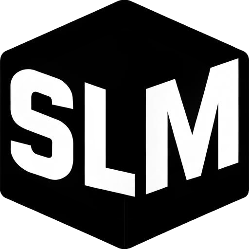
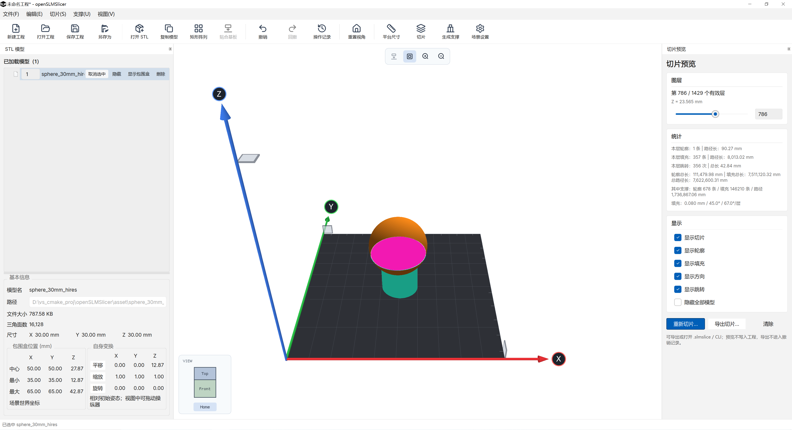
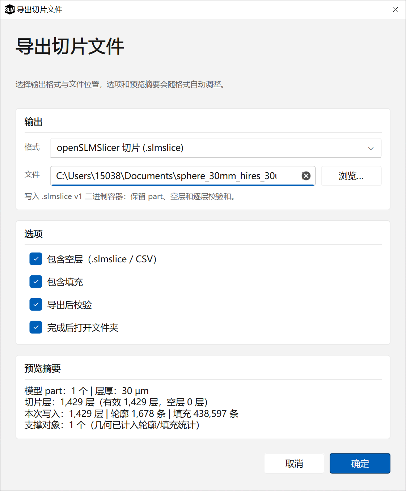
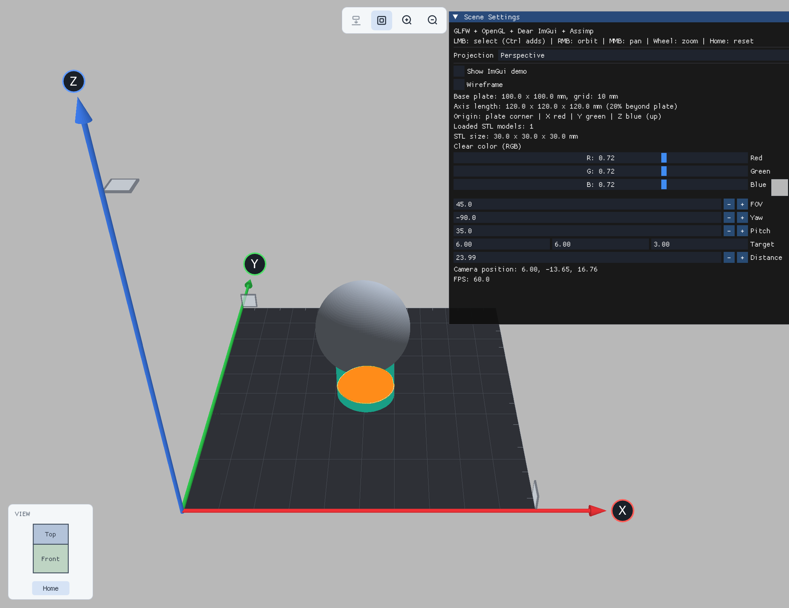

<p align="center">
  
</p>

# openSLMSlicer

openSLMSlicer 是一个面向 SLM（选区激光熔化）的 Windows 桌面切片软件原型。它把模型排版和切片预览放在同一个三维场景中：导入 STL 后在平台上摆放、变换和阵列，设置层厚、扫描间距等参数，逐层查看轮廓与填充，并导出切片文件。

## 界面预览

### 主界面
Fluent 风格的主窗口：顶部是菜单与工具栏，左侧“STL 模型”面板显示模型树和模型信息，中央 3D 视口显示平台、坐标轴和切片预览，右侧“切片预览”面板控制层号，并显示轮廓、填充、跳转的路径统计与显示开关。图中球体模型已生成青绿色支撑，品红色为第 786 / 1429 层的轮廓与填充。

<p align="center">
  
</p>

### 导出切片文件
“导出切片文件”对话框：先选择输出格式（图中为 `.slmslice`）和文件路径，再勾选包含空层、包含填充、导出后校验、完成后打开文件夹等选项；底部“预览摘要”实时汇总模型与支撑数量、层厚、层数以及本次写入的轮廓和填充条数。

<p align="center">
  
</p>

### 场景设置
视口内的“Scene Settings”面板：切换透视 / 正交投影和线框显示，调整平台网格、坐标轴长度与清屏颜色，设置视野、偏航 / 俯仰、相机目标和距离，并显示相机坐标与实时 FPS；视口顶部悬浮按钮可切换轴标记显示和放大 / 缩小视图。

<p align="center">
  
</p>

## 功能

- **模型管理**：一次导入多个 STL，支持选择、隐藏、重命名，显示包围盒和网格信息；视口中左键单击选中并替换原选中，Ctrl+左键追加多选；模型列表首列序号定义切片顺序，可直接修改并撤销 / 回撤
- **场景编辑**：平移 / 旋转 / 缩放参数面板与视口 gizmo 联动，复制、矩形阵列、贴合基板，操作可撤销 / 回撤
- **界面与品牌**：欢迎页显示项目 logo，可新建或打开工程（附最近工程列表）；主窗口顶部是菜单和工具栏，左侧为“STL 模型”树，中央是 3D 视口，右侧为“切片预览”面板，底部状态栏显示操作结果与提示；项目 logo 同时用作窗口图标（标题栏、任务栏）和 Windows exe 文件图标
- **平台与视角**：可调平台尺寸，透视 / 正交投影切换，视角立方体和场景设置
- **视口悬浮工具栏**：视口顶部中间有一组悬浮按钮，当前提供贴合基板、轴最大值方块标记的显示/隐藏、视图放大 / 缩小（后续可继续添加）；选中的模型带有自动支撑时贴合基板按钮不可用，避免 Z 向移动使支撑失效（其他未选中模型上的支撑不影响）
- **切片预览**：基于 PySLM C++ 计算轮廓和扫描填充，逐层查看，可分别显隐轮廓、填充、方向箭头和跳转，并统计路径长度
- **自动支撑**：一键为所有模型生成 45° 悬垂实体块状支撑；已有支撑的模型跳过，无需支撑的模型记为“无需支撑”；模型列表为树形结构，每个模型的支撑作为其子项（可展开 / 收起；一个模型可生成多个支撑，每个互不相连的支撑区域一个子项），每个支撑可单独显示 / 隐藏（只影响显示，不影响切片与导出）；支撑在视口中以青绿色显示、切片预览中以橙色显示（与支撑体区分），XY 平移时跟随模型，旋转 / 缩放 / Z 平移时自动删除；支撑参与切片预览与导出，并在切片面板单独统计
- **工程文件**：`.slmproj` 单文件工程（v6 起保存支撑），内嵌 STL 数据，附带最近工程记录
- **切片导出**：`.slmslice` 内部容器（逐层 SHA-256）、CLI 2.0 ASCII、SVG/PNG 联系人表、CSV 逐层统计；导出后自动回读校验层数、轮廓/填充数与路径长度

## 技术栈

- C++20 + CMake
- Qt Widgets（Qt 5 / 6）：主窗口、菜单、工具栏、模型列表和停靠面板
- Fluent-Qt 1.11.0（仓库内 `3rd_party/fluent_qt`，Fluent 风格 Qt Widgets 组件库）：菜单栏/菜单、按钮、勾选框、滑杆、文字排版、卡片式分区和对话框骨架；只负责 Qt 界面，不涉及 OpenGL 视口
- GLFW + OpenGL 3.3 + Dear ImGui + ImGuizmo：中央 3D 视口和变换 gizmo
- Assimp：模型导入；GLM：数学计算
- PySLM C++：切片轮廓与填充计算，以及自动支撑（悬垂识别 + 实体块状支撑体积）；仓库内 `pyslm_cpp/` 保存了裁剪后的 PySLM C++ 0.6.1 源码，与主程序一起编译，保证编译器、MSVC 运行时库和 Debug/Release 配置一致
- Qt 资源系统（qrc）：工具栏 SVG 图标和项目 logo 编译进程序；`openSLMSlicer/app.rc.in` 为 Windows exe 写入图标和版本信息

Qt 界面的 Fluent 化集中在 `openSLMSlicer/fluent_ui.{h,cpp}`（启动初始化、语义调色板、
原生控件样式表、Fluent 控件工厂）；Fluent-Qt 本体是为兼容 Qt 5.14.2 打过补丁的仓库内副本，
补丁和升级步骤见 [3rd_party/fluent_qt/FLUENTQT_VENDOR.md](3rd_party/fluent_qt/FLUENTQT_VENDOR.md)。

## 目录结构

| 路径 | 内容 |
| --- | --- |
| `openSLMSlicer/` | 程序源码，包括窗口、视口、切片引擎、导出与工程读写 |
| `openSLMSlicer/tests/` | 工程、界面流程、切片和导出测试；`--capture-*` 模式可截图验收界面 |
| `docs/` | `.slmslice` 规格、SVG/PNG/CSV 报告格式与切片输出设计文档 |
| `asset/` | 示例 STL、着色器、工具栏图标和项目 logo（`logo/slm_logo.png` / `logo/slm_logo.ico`）等资源 |
| `slmproj/` | 示例工程和切片文件 |
| `pyslm_cpp/` | 裁剪后的 PySLM C++ 0.6.1 源码（`src/`、`include/` 和编译所需 `third_party/`；去掉示例、测试、文档、构建产物与预编译包） |
| `3rd_party/` | GLFW、Dear ImGui、GLAD、GLM、Assimp、ImGuizmo 等第三方依赖，以及 Fluent-Qt 副本 `fluent_qt/` |
| `CMakePresets.json` | Windows 构建预设（`x64-debug` / `x64-release` 等） |

## 构建

需要 Windows x64、CMake ≥ 3.24、带 C++20 的 MSVC（VS 2022 或更新）和 Qt 5 / 6 的 msvc 版本。GLFW、Dear ImGui、Assimp、Fluent-Qt 等依赖与裁剪后的 PySLM C++ 源码都随仓库提供，除 Qt 外无需额外安装。

预设文件 [CMakePresets.json](CMakePresets.json) 使用 Ninja，并以 `out/build/<preset>` 作为构建目录；其中的 `CMAKE_PREFIX_PATH` 指向开发机上的 Qt，需要改成你本机的 Qt 路径（也可以在命令行覆盖）：

```powershell
cmake --preset x64-release -DCMAKE_PREFIX_PATH="D:/Qt/Qt5.14.2/5.14.2/msvc2017_64"
cmake --build out/build/x64-release
ctest --test-dir out/build/x64-release --output-on-failure
```

产物在 `out/build/<preset>/openSLMSlicer/`；构建后 PySLM 及其依赖 DLL、MSVC 运行时 DLL 会一起复制到输出目录，可以直接运行。PySLM 源码路径可用 `-DPYSLM_CPP_SOURCE_DIR=<path>` 覆盖（默认 `pyslm_cpp/`）；Fluent-Qt 源码路径可用 `-DFLUENTQT_SOURCE_DIR=<path>` 覆盖（默认 `3rd_party/fluent_qt`）。

## 切片输出

切片预览有效时，可通过“切片 → 导出切片文件…”（或预览面板的“导出切片…”）导出当前快照，支持五种格式：

| 格式 | 用途 | 说明 |
| --- | --- | --- |
| `.slmslice` | 内部无损容器 | 保存逐层几何、空层、模型/支撑归属、内外轮廓和填充线，逐层 SHA-256；可重新打开预览或另存为其他格式 |
| `.cli` | 通用几何交换 | CLI 2.0 ASCII，只含层几何，可给支持 CLI 的第三方软件导入 |
| `.svg` | 预览/报告 | 联系人表：每个非空层一格，含层号与 Z 标签，矢量可缩放 |
| `.png` | 预览/报告 | 与 SVG 同版式的位图联系人表，直接编码生成，不依赖 Qt 图片插件 |
| `.csv` | 统计/CI | 每层一行：层号、Z、空层标记、轮廓/填充数量与路径长度 |

导出只读取当前预览快照，不会重新切片，也不修改工程；写入使用临时文件原子替换，支持取消。勾选“导出后校验”会回读文件，校验层数、轮廓数、填充数和路径长度（CLI 因坐标按 4 位小数写出，只校验数量）。

需要说明的是：CLI 输出只包含几何，SVG/PNG/CSV 是报告/统计产物，它们都不包含激光功率、扫描速度等工艺参数，不能直接用于设备加工；面向设备的 OVF、3MF 尚未实现。各报告格式的字段和校验规则见 [docs/slice-report-formats.md](docs/slice-report-formats.md)。

## 文档

- [docs/slmslice-v1.md](docs/slmslice-v1.md)：`.slmslice` 文件布局、字段和版本兼容规则
- [docs/slice-report-formats.md](docs/slice-report-formats.md)：SVG/PNG/CSV 报告格式、字段与校验规则
- [docs/slice-output-design.md](docs/slice-output-design.md)：切片输出格式的设计与演进计划

## 说明

项目目前面向 Windows x64，Assimp 为随仓库提供的 Windows x64 预编译库。PySLM C++ 使用仓库内的 `pyslm_cpp/` 源码（不再依赖预编译包），作为子工程和主程序一起编译（需要 CMake ≥ 3.24；该目录是 PySLM C++ 0.6.1 的最小可编译子集，许可证见其 `LICENSE` 与 `THIRD_PARTY_NOTICES.md`）；可用 `-DPYSLM_CPP_SOURCE_DIR=<path>` 指定其他源码目录。构建后输出目录会复制 PySLM 及其依赖的 DLL，MSVC 运行时 DLL 从本机 VS 工具链 redist 部署，整个工程不依赖预编译的 PySLM 库。

项目 logo 的源文件为 `asset/logo/slm_logo.png`（512 × 512），README、欢迎页和窗口图标使用同一张图；Windows exe 文件图标由 `asset/logo/slm_logo.ico` 提供，`openSLMSlicer/app.rc.in` 在构建时写入图标和版本信息（0.1.0）。

自动支撑当前只生成 PySLM 的**实体块状支撑体积**（不使用其当前版本中不稳定的桁架网格路径）：支撑以 45° 悬垂角识别，需要可用的桌面 OpenGL 环境；“顶板 + 立柱”等支撑落在零件上的拓扑可能漏识别，生成后请人工检查。支撑会作为独立 part 进入切片与导出，CLI 2.0 本身没有 part 归属，支撑几何与模型几何合并输出。

工程文件自 v6 起保存支撑（参数 + 网格三角面 + 归属模型下标），旧版程序打开 v6 工程会提示版本不受支持；新版程序仍可打开 v1–v5 旧工程。
